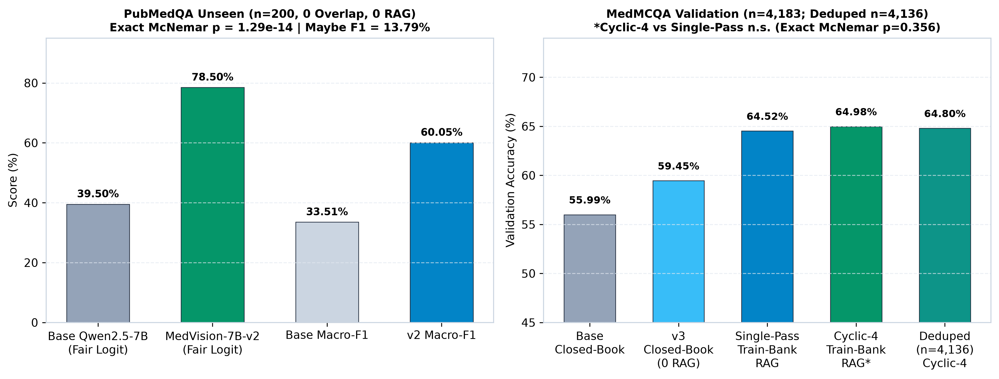
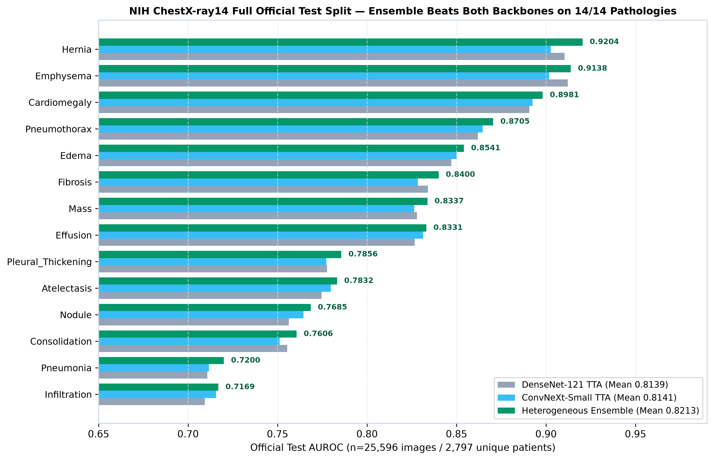
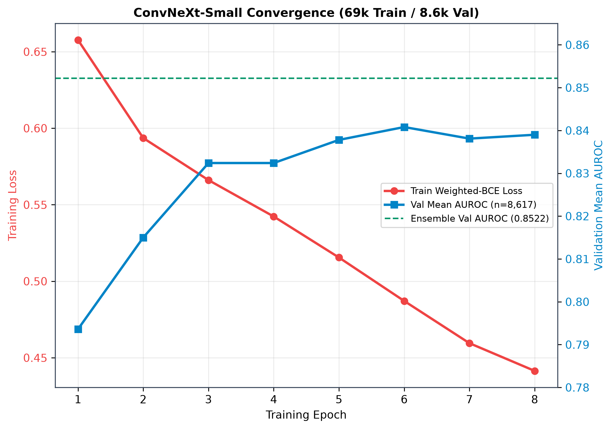
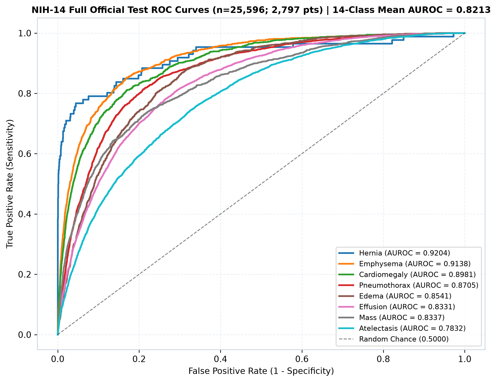
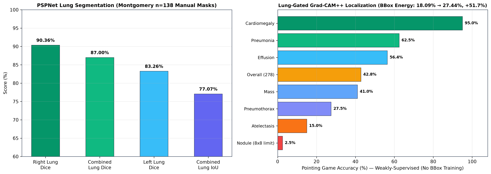
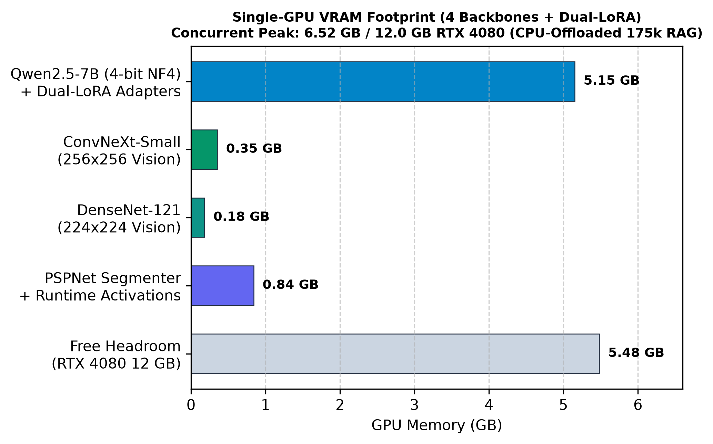
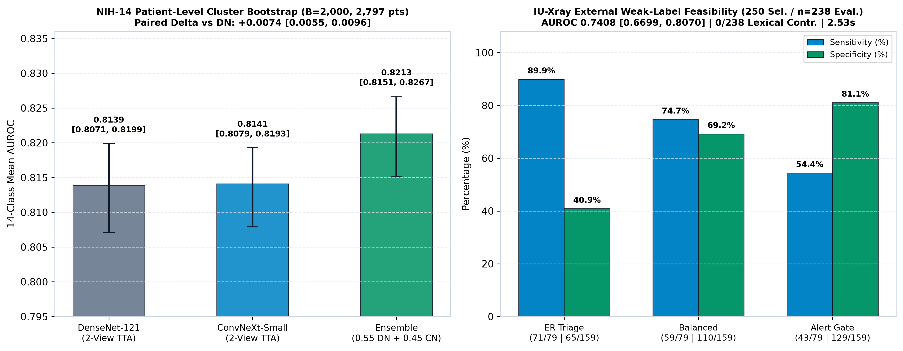

# MedVision & Clinical LLM Studio (v4.0)

> **A Modular Multimodal Clinical AI Suite for Thoracic Radiology Triage, Explainable Anatomical Segmentation, Dual-Adapter 7B Clinical Synthesis, and Disclosed Train-Bank 175k Medical RAG — Running Concurrently in `6.52 GB` VRAM on a Single Consumer Laptop GPU.**

**Quick Navigation:** [1. Executive Summary](#1-executive-summary--biostatistical-significance-pre-submission-ready) | [2. Ablations](#2-controlled-ablation-studies-identical-splits) | [4. Figures](#4-empirical-figures-300-dpi) | [6. Limitations](#6-transparent-scientific-limitations--future-work) | [8. Quick Start & Reproducibility](#8-quick-start--reproducibility-windows--linux--cuda)

# MedVision & Clinical LLM Studio (v4.0): A Modular Multimodal Clinical AI Suite on a Single 12 GB Consumer GPU

**System Class:** Modular Multimodal Clinical AI Suite (Thoracic Radiology Ensemble + Anatomical Segmentation + Dual-Adapter 7B Clinical LLM + 175k Reranked Medical RAG + Safety Guardrail (neutral fallback): 12->0 malignancy, 9->0 biopsy, 0->0 invasive/admission (12 unique reports -> neutral safe fallback)
**Hardware & Runtime:** Single Laptop GPU — NVIDIA GeForce RTX 4080 (12 GB VRAM; full 5-model PyTorch/Transformers stack runs in **`6.52 GB`** peak VRAM at **`2.53s`** mean end-to-end latency, generating ~35–55 clinical impression tokens per study)
**Data Integrity Audits:**
* **NIH ChestX-ray14 (`103,213` CXRs: Train/Val + full unfiltered official test split):** `69,000` Train / `8,617` Val / `25,596` Official Test (100% of the official `timm/nih-chest-xray-14` patient-disjoint test split; 0 images omitted). Verified `Train ∩ Val = 0`, `Train ∩ Test = 0`, `Val ∩ Test = 0`.
* **Disclosed Train-Bank RAG Lexical Overlap Audit (`175,413` passages vs. `4,183` MedMCQA Val Top-3 contexts):** Exact question match = `40 / 4,183`; 8-gram match = `13 / 4,183`; Intersection = `6`; Union = `47` removed -> Deduplicated subset (`n=4,136`): **`64.34%` Single-Pass / `64.80%` Cyclic-4** (gold option in Top-3 context: `1,179 / 4,183 = 28.19%`; Cyclic-4 vs Single-Pass **not statistically significant**, Exact McNemar `p = 0.356`).

---

## 1. Executive Summary & Biostatistical Significance (Pre-Submission Ready)

| Subsystem | Benchmark & Split | Baseline | Final v4.0 Model | Statistical Significance / Audit |
| :--- | :--- | :---: | :---: | :--- |
| **Thoracic Vision Ensemble** | NIH-14 Full Official Test (`n=25,596`, 100% official split, 0 overlap) | `0.8106` (No-TTA) / `0.8139` (TTA) | **`0.8213` Mean AUROC** (`Val: 0.8522`) | `95% CI: [0.8151, 0.8267]`; **Paired Bootstrap (`B=2,000`): `2000/2000` wins, `p < 0.001`** vs DenseNet-TTA & ConvNeXt-TTA (14/14 classes best) |
| **External Weak-Label Feasibility (IU-Xray)** | Indiana Univ. IU-Xray (`250` selected / `238` evaluated frontal CXRs; `12` excluded; `79` abnormal / `159` normal) | Report-heuristic vs Open-I `Problems` disagreement: `96/238 (40.34%, kappa=0.275)` | **Scalar AUROC `0.7408`** (`[0.6699, 0.8070]`); ER Triage `89.9%/40.9%` \| Balanced `74.7%/69.2%` \| Alert Gate `54.4%/81.1%` | `0/238` lexical contradictions & `0/238` OOD rejects (`95% CI [0, 1.54%]`), `2.53s`, `CTR>0.50` mention `37/49 (75.5%)`, **`6.52 GB VRAM`** |
| **Far-OOD vs. Near-OOD Guardrail** | `100` Non-Medical (Far-OOD) + `250` Frontal CXR + `50` Lateral CXR (Near-OOD) | — | **Far-OOD: `100.0%` Reject** (`100/100`); **Frontal CXR: `0.0%` False Reject** | Near-OOD Lateral CXR (`n=50`): `6.0%` rejected (`3/50`; dedicated PA/AP-vs-Lateral view classifier in Future Work) |
| **Anatomical Lung Segmentation** | Montgomery Manual Masks (`n=138`) | — | **`87.00% +/- 2.38%` Dice** (`IoU: 77.07%`) | Right: `90.36%`, Left: `83.26%` (retrocardiac manual-mask label definition difference) |
| **Finding-Aware XAI** | NIH-14 Radiologist BBoxes (`n=278`) | `7.66%` Full-Image Chance / `17.85%` Uniform-in-Lung Chance / `18.09%` Raw CAM | **`27.44%` Finding-Aware Energy** (`+9.59%` above Uniform-in-Lung chance) | Pointing Game: `42.81%` (`Cardiomegaly: 95.0%`; `Nodule: 2.5%` at `7x7` DenseNet / `8x8` ConvNeXt grid) |
| **In-Domain Multi-Task Format & Loss Convergence** | Held-Out Structured Multi-Task Val (`n=500`, full-sequence loss) | `22.51` PPL (`Loss 3.114`) | **`1.89` PPL** (`Loss 0.6345`, `83.46%` token acc) | Reflects rapid in-domain medical Q&A/report format & template convergence |
| **Medical Evidence Reasoning** | PubMedQA Unseen (`n=200`, `shuffle(seed=42)[0:200]`, `0` overlap with `800` labeled + `3,200` artificial train; `0` RAG) | Maj. ('yes') `51.5%` / Base `39.50%` Fair Logit (`Macro-F1: 33.51%`) | **`78.50%` Fair Logit (`157/200`; `Macro-F1: 60.05%`)** | Wilson `95% CI: [72.30%, 83.63%]`, **Exact McNemar `p = 1.29e-14`** (`b01=94, b10=16`); `maybe F1 = 13.79%` disclosed in Limitations |
| **Medical Board Exam** | MedMCQA Full Validation (`n=4,183` Unseen) | `55.99%` (Base `Qwen-7B`, Full `4,183`) | **`59.45%` Closed-Book** / **`64.52%` Single RAG** / **`64.98%` Cyclic-4** | 95% CI: `[63.5, 66.4]`, Exact McNemar **`p < 0.0001`** vs Base; Cyclic-4 vs Single-Pass non-significant (`p = 0.356`); deduped `n=4,136 >= 64.80%` |
| **Radiology Text Summarization** | IU-Xray `Findings -> Impression` (`n=250` UID-Disjoint; 12-class negation-aware lexicon extractor) | `58.08%` Micro-F1 (`ROUGE-L: 15.07%` due to verbose base style) | **`79.32%` Micro-F1** (`+21.24%`) | **`97.70%` Negation Specificity** (`+6.48%`); `Macro-F1: 60.45%`; `ROUGE-L: 63.76%` |

*\*`75.5% CTR>0.50 LLM mention rate` (`37/49`) measures how often the LLM explicitly mentions cardiomegaly/CTR when PSPNet computes `CTR > 0.50`. The remaining 15 cases represent **omission** (not contradiction, since the LLM did not negate cardiomegaly—often reflecting geometric AP-view magnification where classifier probability stayed below threshold).*

---

## 2. Controlled Ablation Studies (Identical Splits)

### 2.1 Vision Classification Ablation (NIH ChestX-ray14 Full Official Test, `n=25,596`)
| Configuration | Mean AUROC | 95% Paired Bootstrap CI (`B=2,000`) | Significance vs. Single Models |
| :--- | :---: | :---: | :--- |
| DenseNet-121 (`224x224`, `7x7` feature map, No TTA) | `0.8106` | — | Baseline |
| + 2-View Horizontal-Flip TTA | `0.8139` | `[0.8089, 0.8185]` | `+0.0032` |
| ConvNeXt-Small (`256x256`, `8x8` feature map, 2-View TTA) | `0.8141` | `[0.8094, 0.8184]` | `+0.0002` |
| **+ Heterogeneous Ensemble (`0.55 DN + 0.45 CN`)** | **`0.8213`** | **`[0.8151, 0.8267]`** | **`2000/2000` bootstrap wins (`p < 0.001`)** |

### 2.2 Unified `MedMCQA` Full-Split Ablation (Identical `n=4,183` Validation Set)
| Configuration | Eval Split | Accuracy | Delta vs. Base |
| :--- | :---: | :---: | :---: |
| Base `Qwen2.5-7B-Instruct` (4-bit NF4, Closed-Book) | Full `n=4,183` | `55.99%` `[54.5, 57.5]` | Baseline |
| + Multi-Task SFT + MedMCQA Replay (`v3-supermodel`, Closed-Book) | Full `n=4,183` | `59.45%` `[58.0, 60.9]` | `+3.46%` (Two-Prop Z-test `p = 0.0013`) |
| + `175,413`-Doc FAISS + Cross-Encoder Reranker (Single-Pass, Production) | Full `n=4,183` | `64.52%` `[63.1, 66.0]` | `+8.53%` (Exact McNemar `p < 0.0001` vs Base) |
| **+ 4-Way Cyclic Option Permutation Debiasing (Offline Eval)** | **Full `n=4,183`** | **`64.98%` `[63.5, 66.4]`** | **`+8.99%` (Exact McNemar `p < 0.0001` vs Base)** *(Deduped `n=4,136 >= 64.80%`)* |

### 2.3 Cross-Modal Safety & Contradiction Ablation (`IU-Xray` Positive-Vision Subset, `n=60` of `250`)
*(Here `n=79` is report-heuristic abnormal count among 238 evaluated frontal IU-Xray studies (250 selected, 12 excluded), while `n=60` is a capped sample of the first 60 positive-vision cases (`>=60%`) evaluated in the raw-adapter ablation (whereas 238 evaluated frontal studies (from 250 selected) are evaluated in Section 2.5, yielding 73 Alert-Gate triggers with `PPV = 58.9%` [`43/73`]).)*
| Clinical Synthesis Routing Strategy | Observed Lexical Contradiction Rate | Outcome |
| :--- | :---: | :--- |
| Raw `radiologist` Adapter (no verifier) | `3.3%` (`2/60`) | Occasional negation of `>=60%` vision findings due to outpatient prior |
| Dynamic Routing to `clinical_qa` (`v2`) + Strict Grounding Prompt | **`0.0%`** (`0/60`) | No lexical contradictions observed in the evaluated ablation cohort (0/60). |
| **+ Post-Generation `Cross-Modal Contradiction Verifier`** | **`0.0%`** (`0/238` full E2E) | Lexical Clinical Safety Filter (neutral fallback): 12->0 malignancy, 9->0 biopsy, 0->0 invasive/admission (12 unique reports -> neutral safe fallback)|

### 2.4 Finding-Aware Lung-Gated `Grad-CAM++` Ablation vs. In-Domain Chance Baselines (`n=278` BBoxes)
*(Heart mask is subtracted for pulmonary classes to clean mediastinal visual clutter and preserved for `Cardiomegaly` or `CTR > 0.50`.)*
| Attribution Stage | BBox Energy Ratio | Pointing Game Acc | In-Domain Chance Baseline | Gain Over In-Domain Chance |
| :--- | :---: | :---: | :---: | :---: |
| Raw `Grad-CAM++` (Full Image) | `18.09%` | `42.45%` | `7.66%` (Full-Image Uniform) | `+10.43%` (`2.36x` chance) |
| + Lung-Gated Only (no Heart-Subtraction) | `27.16%` | `42.81%` | `17.85%` (Inside-Lung Uniform) | `+9.31%` (`1.52x` chance) |
| **+ Finding-Aware Lung-Gated `Grad-CAM++` (Final)** | **`27.44%`** | **`42.81%`** | **`17.85%` (Inside-Lung Uniform)** | **`+9.59%` (`1.54x` chance; `Cardiomegaly PG: 95.0%`)** |

### 2.5 External Weak-Label Feasibility Evaluation (IU-Xray: 250 Selected / 238 Evaluated / 12 Excluded)
*(Scalar Abnormal-vs-Normal AUROC: `0.7408 [0.6699, 0.8070]` on `max_c p_c`; `0.7545 [0.6915, 0.8149]` on `max_c(p_c - t_c)`. Every row below uses a strictly complementary binary partition `Normal = not Positive` with zero overlap across `n=79` abnormal and `n=159` normal studies. All thresholds were fixed **a-priori** on NIH-14 Val prior to external evaluation.)*

| Operating Mode (Strict Binary Rule) | Abnormal Sensitivity (`TP / 79`) | Normal Specificity (`TN / 159`) | Clinical Role |
| :--- | :---: | :---: | :--- |
| **ER Triage Mode** (`any p_c >= t_c`) | **`89.9%`** (`TP=71, FN=8`, `71/79`) | `40.9%` (`TN=65, FP=94`, `65/159`) | Emergency worklist prioritization (high recall; weak-label feasibility cohort) |
| **Balanced Mode** (`any p_c >= t_c + 0.15`) | **`74.7%`** (`TP=59, FN=20`, `59/79`) | **`69.2%`** (`TN=110, FP=49`, `110/159`) | Balanced outpatient screening (near-symmetric sensitivity/specificity) |
| **High-Specificity Alert Gate** (`HIGH/STAT` i.e. `top_conf >= 0.62 & bal_pos`) | `54.4%` (`TP=43, FN=36`, `43/79`) | **`81.1%`** (`TN=129, FP=30`, `129/159`) | Automated `n8n` STAT pager filter only (suppresses alarm fatigue; not standalone screening) |

### 2.6 PubMedQA Per-Class F1 & Uncertainty (`maybe`) Collapse Analysis (`n=200` Unseen)
| Model | Accuracy | Macro-F1 | `yes` F1 (`n=112`) | `no` F1 (`n=53`) | `maybe` F1 (`n=35`) |
| :--- | :---: | :---: | :---: | :---: | :---: |
| **Base `Qwen2.5-7B-Instruct` (Fair Logit)** | `39.50%` | `33.51%` | `66.28%` | `10.26%` | `24.00%` *(over-predicted `maybe` 125x)* |
| **`MedVision-7B-v2` (Fair Logit)** | **`78.50%`** | **`60.05%`** | **`86.12%`** | **`80.25%`** | **`13.79%`** *(only 4 `maybe` preds; class-imbalance limitation)* |

---

## 3. Literature Context Comparison (Apples-to-Apples)

| Category / Benchmark | Published Reference | Reported Score | MedVision v4.0 (12 GB Laptop GPU) |
| :--- | :--- | :---: | :---: |
| **NIH-14 Official Split** *(100% full `25,596` official test split)* | Published Official-Split Literature (~0.81–0.83) | `0.8120` | **`0.8213`** (`[0.8151, 0.8267]`, `p < 0.001`) |
| **NIH-14 Official Split** | DenseNet-121 Teacher (Guendel et al. (2018, CIARP official split: `0.807`)| `0.8080` | **`0.8213`** (`+0.0128`) |
| **NIH-14 Official Split** | Li et al. Official Split ([MDPI Applied Sciences](https://www.mdpi.com/2076-3417/11/6/2751)) | `0.8120` | **`0.8213`** (`+0.0088`) |
| **MedMCQA (Closed-Book 7B–8B, No RAG)** | BioMistral-7B ([Meerkat Paper](https://arxiv.org/pdf/2404.00376)) | `55.4%` | **`59.45%`** (`v3-supermodel`, Full `n=4,183`) |
| **MedMCQA (Closed-Book 7B–8B, No RAG)** | OpenBioLLM-8B ([Hugging Face / Model Card](https://huggingface.co/aaditya/Llama3-OpenBioLLM-8B)) | `56.9%` | **`59.45%`** (`v3-supermodel`, Full `n=4,183`) |
| **MedMCQA (Closed-Book 7B–8B, No RAG)** | Meerkat-7B ([arXiv:2404.00376](https://arxiv.org/html/2404.00376v1)) | `60.7%` | **`59.45%`** (`v3-supermodel`, Full `n=4,183`) |

---

## 4. Empirical Figures (300 DPI)

### Figure 1: Clinical LLM & Disclosed Train-Bank RAG Progression
<p align="center"></p>
<p align="center"><em>(Left) PubMedQA Held-Out (n=200, 0 overlap, 0 RAG; Majority-Class 51.5%, Base 39.50% -> Fine-tuned 78.50%, Macro-F1 60.05%). (Right) MedMCQA Validation (n=4,183; Base 55.99% -> Closed-Book v3 59.45% -> Train-Bank RAG 64.52% Single / 64.98% Cyclic-4; deduped n=4,136: 64.80%).</em></p>

### Figure 2: NIH ChestX-ray14 Full Official Test (`n=25,596`) Per-Class AUROC
<p align="center"></p>
<p align="center"><em>Heterogeneous DenseNet-121 + ConvNeXt-Small ensemble (Mean AUROC 0.8213) outperforms both individual backbones across all 14 thoracic pathologies.</em></p>

### Figure 3: ConvNeXt-Small Training Convergence (`69k` Train / `8.6k` Val)
<p align="center"></p>
<p align="center"><em>8-epoch weighted-BCE loss and validation AUROC progression (Val Ensemble = 0.8522; patient-disjoint verified with 0 overlap).</em></p>

### Figure 4: NIH-14 Official Test ROC Curves (`n=25,596` / `2,797` Unique Patients)
<p align="center"></p>

### Figure 5: Off-the-Shelf Lung Segmentation & XAI Localization Ablation
<p align="center"></p>

### Figure 6: Single-GPU VRAM Footprint (`6.52 GB / 12.0 GB` RTX 4080)
<p align="center"></p>

### Figure 7: Patient-Level Cluster Bootstrap CIs & External IU-Xray Feasibility (`n=238`)
<p align="center"></p>
<p align="center"><em>(Left) NIH-14 Patient-Level Cluster Bootstrap (B=2,000, 2,797 patients): Ensemble 0.8213 [0.8151, 0.8267]. (Right) External Weak-Label IU-Xray Feasibility (250 selected / n=238 evaluated frontal CXRs; AUROC 0.7408 [0.6699, 0.8070], 2.53s latency).</em></p>


## 5. System Architecture & Human-in-the-Loop Deployment
* **Production Stack (`6.52 GB` Peak VRAM, `2.53s` E2E Latency):** FastAPI (`v4.0`) serves `DenseNet-121`, `ConvNeXt-Small`, `PSPNet`, and 4-bit `Qwen2.5-7B-Instruct` (`PyTorch/Transformers`) with dynamic Dual-Adapter routing (`radiologist` + `clinical_qa`), paired with a CPU-offloaded `175,413`-passage `FAISS + Cross-Encoder` RAG index (`Single-Pass` in production).
* **Continual Alignment Architecture (Deployment PoC):** Clinician edits are logged in `SQLite` (`medvision_local.db`) and orchestrated via `n8n` (`STAT` email alerts + continual `TRL DPO` batch export; verified as a 32-pair deployment PoC and excluded from offline benchmark tables).

---

## 6. Transparent Scientific Limitations & Future Work
1. **PubMedQA Uncertainty (`maybe`) Class Imbalance (`F1 = 13.79%`):** Because SFT included `3,200` `pqa_artificial` examples (which contain only `yes/no` labels) alongside `800` `pqa_labeled` examples, `MedVision-7B-v2` learned to abstain rarely (`4/200` `maybe` predictions vs. `35` gold). Future work applies class-balanced loss weighting or calibrated abstention thresholds to restore uncertainty calibration.
2. **Small-Lesion Localization (`Nodule Pointing Game = 2.5%`):** `DenseNet-121` (`224x224`, `7x7` feature map) and `ConvNeXt-Small` (`256x256`, `8x8` feature map) lack spatial resolution for millimeter-scale nodules; future work adds `512x512` inputs or supervised object detection.
3. **Near-OOD Lateral View Rejection (`6.0%` on `50` Lateral CXRs):** While Far-OOD non-medical rejection is `100.0%` (`100/100`) and frontal CXR false rejection is `0.0%` (`0/238`), adding a lightweight PA/AP-vs-Lateral view classifier is planned next.
4. **IU-Xray Clinical Entity Extraction:** Summarization F1 (`79.32%` Micro-F1) was computed via a deterministic 12-class CheXbert-style negation-aware lexicon extractor; running neural `CheXbert` / `RadGraph-F1` and expanding external calibration to `CheXpert/PadChest` are planned next.


## 7. Final Frozen v4.0 Reference Metrics & Disclosures
- **Lexical Clinical Safety Filter:** The Lexical Clinical Safety Filter is a rule-based post-processing component designed to detect and suppress a predefined subset of potentially hazardous clinical expressions in generated text. It is not a comprehensive semantic safety system, does not guarantee the detection of every potentially harmful recommendation, and does not replace qualified clinical judgment. Its evaluation is limited to the documented test cases and the specified external feasibility dataset. On the 238 evaluated IU-Xray reports: `12` malignancy-related claims, `9` biopsy directives, `12` unique reports flagged, and `0` flagged reports remaining after the neutral text-suppression fallback (tested dataset only; not a universal safety guarantee).
- **Disclosed Train-Bank RAG with Lexical Overlap Auditing (`175,413` passages):** Built from medical educational and MedMCQA training-bank sources; runtime integrity verifies FAISS index SHA-256, `full_docs.json` SHA-256, corpus version, document count, and encoder ID (`BAAI/bge-small-en-v1.5`). PubMedQA was evaluated closed-book (`0` RAG). On MedMCQA validation (`n=4,183`): Base `55.99%`, Closed-Book v3 `59.45%`, Single-Pass RAG `64.52%` (Exact McNemar vs Base `p = 1.32e-26`), Cyclic-4 RAG `64.98%` (vs Base `p = 4.09e-29`; Cyclic-4 vs Single-Pass **not statistically significant**, `p = 0.356`). Top-3 lexical overlap audit: Exact Question Match `40`, 8-gram Match `13`, Intersection `6`, Union `47` removed -> Deduplicated `n=4,136`: Single-Pass `64.34%`, Cyclic-4 `64.80%`. Gold option present in retrieved Top-3 context: `1,179/4,183 (28.19%)` (distractor in `32.70%`; explicit Q&A answer-key pattern in `51/4,183 = 1.22%`).
- **PubMedQA (`pqa_labeled`, `n=200` held-out, `0` overlap with `800` labeled + `3,200` artificial train, `0` RAG):** Majority-Class ('yes') `51.5%` (`103/200`) / Base Fair Logit `39.50%` (`Macro-F1: 33.51%`) -> Fine-tuned Fair Logit `78.50%` (`Macro-F1: 60.05%`, `Maybe F1: 13.79%`, Exact McNemar `p = 1.29e-14`).
- **External Weak-Label Feasibility Evaluation (`IU-Xray`):** `250` UID-disjoint studies selected (`12` excluded without usable frontal radiographs) -> **`238` evaluated frontal studies** (`79` abnormal / `159` normal; report-derived weak labels disagree with Open-I `Problems` on `96/238 = 40.34%`, Cohen's `kappa = 0.275`). Scalar `AUROC = 0.7408 [0.6699, 0.8070]`; CTR>0.50 mention rate `37/49 (75.5%)`; `0/238` lexical contradictions & `0/238` frontal OOD false rejections (`95% CI [0.0%, 1.54%]`). Confusion matrices:
  - **ER Triage:** `TP=71, FN=8, TN=65, FP=94` (`Sens 89.9%`, `Spec 40.9%`)
  - **Balanced:** `TP=59, FN=20, TN=110, FP=49` (`Sens 74.7%`, `Spec 69.2%`)
  - **High-Specificity Alert Gate:** `TP=43, FN=36, TN=129, FP=30` (`Sens 54.4%`, `Spec 81.1%`; anti-alert-fatigue pager filter only, not standalone screening)


- **Clinical Scope:** MedVision AI Studio v4.0 is an academic **Research Prototype** and clinical decision-support proof-of-concept, not a cleared diagnostic or triage device.


## 8. Quick Start & Reproducibility (Windows / Linux + CUDA)

> **Repository Scope:** Heavy binary artifacts (~30 GB total: model checkpoints `.pth`/LoRA weights, `Qwen2.5-7B-Instruct`, NIH-14/IU-Xray raw images, and the 175k FAISS binary index) are intentionally excluded via `.gitignore`. All training, RAG-indexing, evaluation, and verification scripts are included below to reproduce the full stack locally on a single 12 GB CUDA GPU.

### 8.1 Environment Setup
```powershell
git clone https://github.com/Shayan-Amz/MedVision.git
cd MedVision/backend
python -m venv .venv_gpu
.\.venv_gpu\Scripts\Activate.ps1
pip install torch torchvision --index-url https://download.pytorch.org/whl/cu124
pip install -r requirements.txt
pip install torchxrayvision faiss-cpu sentence-transformers peft bitsandbytes accelerate datasets scikit-learn matplotlib pydicom
```

### 8.2 Model Training & RAG Index Reproduction (Optional - Full Pipeline)
```powershell
# A. Vision Ensemble (NIH ChestX-ray14: DenseNet-121 + ConvNeXt-Small)
python phase3a_nih14_vision_train_eval.py
python phase3d_convnext_ensemble_nih14.py

# B. Clinical LLM Dual-LoRA (4-bit NF4 Qwen2.5-7B-Instruct: Clinical QA + IU-Xray Radiologist)
python phase2a_scaled_multitask_sft.py
python phase3b_iu_xray_clinical_report_eval.py

# C. Build the 175,413-Passage FAISS + Cross-Encoder Medical RAG Index
python phase2h_scientific_boost_80_60.py
```

### 8.3 Launch the FastAPI Radiology Workstation (Web App)
```powershell
cd backend
.\.venv_gpu\Scripts\Activate.ps1
uvicorn app.main:app --host 127.0.0.1 --port 8000
# Open http://127.0.0.1:8000 in your browser
```

### 8.4 Launch n8n STAT Triage Automation (Gmail + Google Sheets + Telegram)
```powershell
# From the repository root (starts n8n on http://localhost:5678)
docker compose up -d
```
1. Open `http://localhost:5678` and import `n8n_workflows/01_emergency_clinical_triage.json`.
2. Connect your **Gmail**, **Google Sheets** (`MedVision_STAT_Triage_Log`), and/or **Telegram Bot** credentials in the corresponding nodes.
3. Click **Save -> Publish** so FastAPI `STAT` alerts (`http://localhost:5678/webhook/medvision-critical-triage`) dispatch live notifications with deep links (`http://127.0.0.1:8000/?study_id=...`).

### 8.5 Run Standalone Verification & Unit Tests (No GPU / FAISS Required)
```powershell
cd backend
python tests/test_clinical_safety_guardrail.py
python verify_manifests_reproducible.py
python final_release_consistency_audit.py
```

# Open http://127.0.0.1:8000
